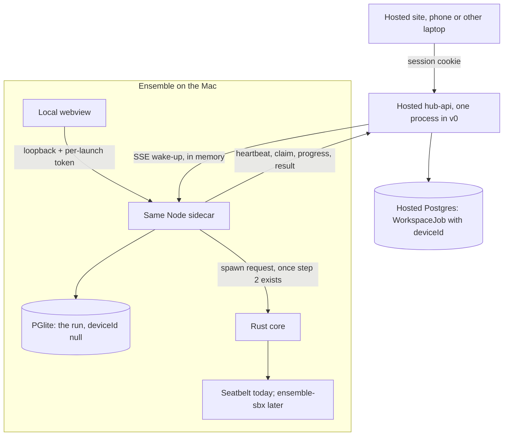
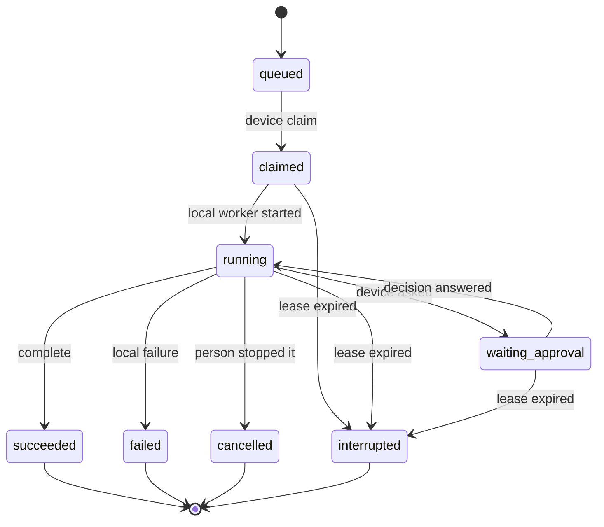

# 25 · Remote tasks on your computer

Status: Draft for review · 2 Oct 2026
Sections: **Hosting** (§3), **ensemble-app** (§4, the API and the site), **desktop and sandbox** (the rest).
Hosting and ensemble-app review their sections before this merges. Do not merge on the desktop owner's behalf.

Companions: [23 · Local desktop design](23_LOCAL_DESKTOP_DESIGN.md), [24 · Desktop sandboxing](24_DESKTOP_SANDBOXING.md).

Checked against `main` at `c6cc889` (PR #32 is merged). Where a note disagrees with the tree, the text says what the code does.

## 0. Summary

v0 of the hosted app is Postgres, Next.js, and the API. The person also has the desktop app open on their Mac. From the hosted site, on a phone or another laptop, they assign a task. The task runs on that Mac, because a cloud VM is too expensive. It uses the Mac's model key and git credentials, and the same sandbox, trust, permission, and unattended rules as a task started in the desktop app.

The hosted side carries the assignment, the progress, the approvals, and the result. It does not carry keys, credentials, or file contents. If the Mac is offline, the task waits. It does not run on the server instead.

Public hosted accounts must verify email before assigning device work. Host execution/operator restrictions do not grant operators access to another user's device and do not block verified users from their own device. Assignments are subject to per-user hosted job quotas.

**The CLI is a second runner.** `ensemble` ([26](26_CLI.md)) starts the same sidecar without the desktop window. `ensemble login` approves the computer from the `/link` page; when "Run tasks" is approved, the server returns a one-time pairing code and the CLI pairs through the local `POST /api/remote/pair`, exactly as the desktop app does. The device shows its version as `cli-<version>`. Folders shared with `ensemble folders add` are the labels the assign dialog offers. The runner, logout and unpair behave as below.

The local UI and the hosted site are two front doors to one on-device runner. Remote assignment is a new way to reach that runner, so the Mac treats the server as untrusted input.

Desktop step 1 is on `main` (PR #32): Tauri, a static export, one Node sidecar on PGlite, and the discovery file. The sandbox broker, the trust rules, and the Git gate in docs 23 and 24 are designed and not built.

The headline path is walkthrough (a) in §9: from the phone, clone a private repo, change it, commit, and push. That path first works after the Git gate lands, which is desktop steps 2 and 4 (doc 23 §14, doc 24 §9), and after the person turns on the Mac setting in §5.1. Until the Git gate lands, private clone and push are refused, so the first real end-to-end test uses public-repo tasks. The protocol can be built before either.

### Must-fix before remote tasks ship

These two are blockers. Remote tasks do not ship with either one still open.

1. **`deviceId: null` on the server job loop.** `tick()` in `apps/hub-api/src/workspace/worker.ts` loads every `queued` job (the query is line 107) and `claim()` runs it in this process. `recover()` (line 144) marks every `running`, `stopping`, and `waiting_approval` job `failed` ("Interrupted: Ensemble restarted…") on API boot. A device job is a `WorkspaceJob` with `deviceId` set (§4). Without `where: { deviceId: null }` on both, a restart fails the Mac's job, and the server runs it with the server's model key. The desktop sidecar uses a different database (PGlite). Its own jobs stay `deviceId: null`, so the same filter still runs local work.
2. **`POST /api/tokens` can mint more tokens.** `POST /api/connect/token` refuses callers that are not a browser session (`routes/connect.ts`: `authVia` must be `session`, `bypass`, or `desktop`). `POST /api/tokens` in `routes/auth.ts` has no such check. A leaked `full` token can mint another `full` token. ensemble-app is doing the session check as its own small PR, the same check as the bridge key. That PR is separate from the remote-task work. It lands before any `device` token is issued. A `device` token is also limited to `/api/devices/self/*` (§4.3), and `identify` today maps every scope other than `bridge` to `full` (`lib/auth.ts`).

---

## 1. What already runs an assignment

This is an extension of the current queue, not a second agent. ensemble-app's inventory is in §4. The short version:

| Piece | Where | What it does today |
|---|---|---|
| Assign | `POST /api/agent/assign` in `apps/hub-api/src/routes/agents.ts` | Creates a `WorkspaceJob` and calls `kick()`. `unattended` is hardcoded `false` (line 154). Provider and model come from `settings.models[task.complexity]`. |
| Queue | `apps/hub-api/src/workspace/worker.ts` | `startAgentQueue` is called from `index.ts`. Every 1.5 s, `tick()` claims queued jobs. |
| Claim | `worker.ts` `claim` (line 51) | `updateMany` where `id` and `status = queued`. `count === 1` wins. Sets `leaseOwner` to the process pid. No `SKIP LOCKED` anywhere in the repo. |
| Run | `workspace/agent.ts` `executeJob` | Prepares the folder, calls agent-runtime one turn at a time, runs tools. |
| Policy | `workspace/guard.ts`, `workspace/tools.ts` | Folder jail, argv allow-list, Git ceiling, Seatbelt profile on macOS. |
| Needs me | `tools.ts` `askPerson`, `lib/decisions.ts` | Writes `AgentDecision` (`source: "ensemble"`, `sessionId = job.id`). Answer is `POST /api/decisions/:id/decide`. Wait is `GET /api/decisions/:id/wait`. |
| Live UI | `lib/sse.ts`, `GET /api/events` | In-memory SSE. A ping every 25 s. Frames are invalidation hints. |
| Desktop process | `apps/hub-api/src/desktop/main.ts`, `apps/desktop/src-tauri/src/sidecar.rs` | One Node process. PGlite. Binds `127.0.0.1` on a random port. Writes `api.json` mode `0600`. `REDIS_URL=memory://desktop`. Starts the same hub, so the same queue. |

`WorkspaceJob` already has `externalRoot`, `useCredentials`, `delivery`, `unattended`, `leaseOwner`, and `leaseUntil` (schema lines 469–470). `claim()` writes `leaseOwner` and nothing reads it back. `leaseUntil` is never written. There is no lease expiry. `recover()` is how a dead process gives up a job, and it fails the row.

`orchestration.runWithoutAsking` defaults to `true` (`packages/shared-types/src/assistant.ts`). Settings shows it. The description says folders outside the workspace still ask, unless the run is unattended (`apps/hub-web/components/settings/sections.tsx`). The runner does not read the flag. Doc 24 §5.9 is the rule we implement: unattended on an untrusted folder is `UNATTENDED_REQUIRES_TRUST`. That code does not exist yet.

`WorkspaceJobStatus` today is `queued`, `running`, `stopping`, `waiting_approval`, `blocked`, `succeeded`, `failed`, `cancelled`. §4 adds `claimed` and `interrupted` to that enum. It does not add a second status vocabulary.

---

## 2. One runner, two front doors

Desktop and sandbox.



- A task started in the local UI is a `WorkspaceJob` in PGlite with `deviceId` null. `kick()` runs it. Nothing is sent to the hosted API.
- A task started on the hosted site is a `WorkspaceJob` in hosted Postgres with `deviceId` set (§4). The hosted `tick()` and `recover()` skip those rows. The sidecar claims the hosted row, then creates a **local** job with `deviceId` null and the same instructions, and runs it through `claim` → `executeJob` → `guard` → `tools`. Same locks (`dir:` and `chain:`), same Needs me, same limits. The hosted id is what progress and complete refer to.
- The claim's `task.page` is the task page as Markdown (what the person wrote there, often the main content of the task: a repository link, the steps, what done means), up to 6,000 characters of page text plus 9,500 characters of embedded diagram source (`pageAgentText` in `pages/agent-context.ts`). The same text is also in `task.description` under `## The task page (what the person wrote; the task itself)`, for computers before 0.3.5 that do not read `task.page`. A computer that reads it takes that section out of the description and makes the page its local task's page (`planLocalJob` in `remote/policy.ts`, `remote/accept.ts`), so the agent reads it in the brief like any task page.
- `task.description` carries the page first, then the task's own description, the task's source link and up to 8,000 characters of items the person attached from connected apps to the task or its project ([31 §2.3](31_CONNECTORS_IN_USE.md#23-attach-items-to-a-task-or-project)); then a *Files attached* section with short excerpts of the task's files (up to 1,500 characters each, 6,000 in total; [32](32_FILES.md)); the whole field stays within 20,000 characters (computers before 0.3.5 refuse a longer one). The page is at most 16,000 characters and comes first, so the cut never splits it; a long page leaves less room for the rest. The claim also carries `attachments` with each file's id, name and byte size, and full embedded diagram sources as `.ensemble-diagram.txt` attachments. The paired computer downloads the originals before creating the local task, remaps file and diagram-source references to their local file ids, using its device token and current lease; `remote/accept.ts` saves them as task-tagged local Files. It receives no connected-app tokens. Transfers are limited to 100 MB per task.
- Device-runner mode is a client inside that sidecar, started only when a local flag is on. Default off. The flag lives in the app-data folder. The server cannot turn it on.
- The client opens out to the hosted API. It does not listen. The loopback bind, the discovery file, and `ENSEMBLE_DESKTOP_TOKEN` stay as they are. That launch token is for the local webview. It is not the hosted device token.
- `ENSEMBLE_SITE_URL` is the site the desktop window loads (`apps/desktop/src-tauri/src/site.rs`: that variable, then a saved value, then the compile-time value, then `http://localhost:3000`). `ENSEMBLE_REMOTE_API` is the remote-tasks API address that #43 adds. It is the hosted API base the desktop sidecar uses for remote tasks: pairing, claim, heartbeat, and events.

The sandbox, the trust rules, and the Git gate apply unchanged, once they exist.

- Sandbox (as built 11 Oct 2026, doc 24 v4): Seatbelt on macOS, bubblewrap or Landlock on Linux, the sandbox-runtime account on Windows (one admin prompt per computer). A computer reports its sandbox to the web in its capabilities (`sandboxInfo`: mechanism, whether it works, whether setup is needed; never a path). The Assign dialog shows it and offers the Sandbox toggle; the toggle is sent on the claim (`sandbox`) and applies when the computer accepts web settings (§5.1), otherwise the sandbox stays on. A computer without a working sandbox refuses a sandboxed task with the reason.
- Run-ID clones: a fresh repo task clones into `<workspace>/runs/<job-id>` on `ensemble/<run-id>/<slug>`. Always a clone. Doc 23 §5.
- Git gate, as designed: the agent never sees credentials. The core pushes fast-forward only, to the run's own branch, with the Mac's credentials. That is how a private repo works without putting a token in the sandbox. It is not what the code does today. `lib/git-auth.ts` puts `ENSEMBLE_GIT_TOKEN` in the child environment, and `useCredentials` points `HOME` at the real home and lifts the Seatbelt deny on `.ssh`, `.config/gh`, and `Library/Keychains`.
- Permission tiers, Needs me, trusted folders, and Run unattended: doc 23 §7 and doc 24 §5.8–5.11. Trust is per device and is not synced.

Until the Git gate exists (desktop steps 2 and 4), the sidecar refuses a private clone and a remote push. A public-repo task can proceed (§0). After the gate, a remote fast-forward push to the run's own branch still needs the Mac setting in §5.1, which is off by default. The sandbox PR removes `ENSEMBLE_GIT_TOKEN` from the agent's environment. The app side does the push.

---

## 3. Hosting

Hosting. v0 is one API process. Later scaling is a different transport, and it is not Redis pub/sub on Lambda.

### 3.1 One process in v0

The hosted setup runs one API process and one agent process. Tickets, SSE subscribers, and OAuth `state` stay in that process. v0 of remote tasks assumes that. The live stream (`lib/sse.ts`) and approval wake-ups (`decisionBus` in `lib/decisions.ts`) stay in that process. That is fine for v0. Do not add a bus in order to ship the wake-ups. `device.revoked` is the exception: removing a computer publishes that one notice on Redis pub/sub so every API process closes the stream it is holding. The other frames stay in-process.

The Mac connects out. The phone does not open a port on the home network. While the app is open and remote tasks are enabled, the sidecar signs in with its device token and keeps a connection to `https://api.ensemblework.com`.

- Heartbeat: `POST /api/devices/self/heartbeat` about every 30 s (§4, and `ENSEMBLE_REMOTE_HEARTBEAT_MS` default `30_000` in `apps/hub-api/src/remote/contract.ts`). This is the online dot and the lease renewal. It is not the Redis activity heartbeat. That function lives in `lib/activity.ts` and is called from `workspace/agent.ts` and `assistant/agent.ts` to refresh an activity key. The `Device` model is `model Device` in `apps/hub-api/prisma/schema.prisma`.
- The notify channel is `GET /api/devices/self/events`, backed by the same `sseHub`, on a `device:<id>` key (§4). The browser keeps using `GET /api/events`. `infra/deploy/Caddyfile.example` flushes both paths with `flush_interval -1`. The handler `hijack`s the socket (`apps/hub-api/src/lib/sse.ts`), so the global compress plugin does not buffer those frames.
- Frames are wake-up hints. The Mac still calls claim or the decision long-poll. A dropped stream is not a dropped task.

### 3.2 Later: a second server, or Lambda

These are not v0. Flagged for Hosting.

- **Two or more always-on API servers.** The in-memory hub and `decisionBus` do not cross processes. Redis pub/sub is the fit for that case only: one subscriber per process, one publish per wake-up. Do not publish per log line. Upstash Free is 500,000 commands a month. A quiet pub/sub on top of the existing activity traffic can fit; a per-line channel will not. Postgres `LISTEN/NOTIFY` also needs a connection that stays open, so it is an always-on option, not a Lambda one. Device **writes** (claim, heartbeat, progress, complete) stay Postgres either way. They are not Redis commands.
- **Lambda.** Redis pub/sub does not fit. A Lambda invocation cannot hold a subscription open. `LISTEN/NOTIFY` does not fit for the same reason. On Lambda, the device channel and the browser channel go through Supabase Realtime or API Gateway WebSockets. Claim, heartbeat, progress, and complete stay plain requests so that move does not change the device.

### 3.3 Claim, lease, secrets, free tier

The claim itself is §4.3: one conditional `updateMany`, no `SKIP LOCKED`, a `leaseToken` the device sends back on every write, `leaseUntil` of 120 s (`LEASE_MS` in `apps/hub-api/src/devices/constants.ts`). Claim sets that window. Heartbeat renews it only when `leaseUntil` is still in the future. Progress and ask extend it the same way and refuse a lease that has already expired (`apps/hub-api/src/devices/routes.ts`). The sweep that expires a lease runs on the scheduler's 60 s tick, after `expireStale()` (`jobs/scheduler.ts` uses `setInterval` of `60_000` and calls `sweepExpiredDeviceLeases`). It only touches rows with `deviceId` set. A dead Mac therefore shows as `interrupted` 120 to 180 s after its last heartbeat, not at exactly 120 s. If `ENSEMBLE_SCHEDULER=off`, `startScheduler` returns without the interval, so the sweep never runs and the lease does not expire. The VM sets `ENSEMBLE_SERVER_RUNNER=off` so unassigned code jobs are not run on the server (`serverRunnerEnabled` in `devices/constants.ts`, enforced in `workspace/assign.ts`).

Model keys and GitHub credentials stay on the Mac (doc 23 §3.3 and §9). Server `model_credentials` are for server-side calls. `apps/agent-runtime/ensemble_agent/credentials.py` reads the model keys. The morning fetch reaches a model through `complete()` in `lib/runtime.ts` (`jobs/scheduler.ts` → `connectors/sync.ts` → `triage()`). The morning brief (`cowork/service.ts` `deliverMorningBrief`) uses the Low model and the personal Morning brief skill; if that model cannot answer, it delivers the current overview with an explicit fallback note. A device job never takes either path.

Logs: the Mac batches about every 2 s or 64 KB. The server stores at most 64 KB per chunk and 2 MB per job (`MAX_CHUNK_BYTES` and `MAX_JOB_LOG_BYTES` in `apps/hub-api/src/devices/constants.ts`), redacted with `redactText()` (`lib/redact.ts`). `runRetention` deletes chunks older than 30 days. Those caps are in the code whichever database the host uses. The host can choose between Supabase Free (500 MB) and Postgres on the VM.

### 3.4 Trying it before it is hosted

The numbered check is §4.8. `ENSEMBLE_SITE_URL` is the site the desktop window loads. `ENSEMBLE_REMOTE_API` is the remote-tasks API address that #43 adds. It is the hosted API base the desktop sidecar uses for remote tasks: pairing, claim, heartbeat, and events. It must be http or https, and trailing slashes are trimmed. When it is set, it overrides the API address saved at pairing. When it is unset, the Mac uses the address typed during pairing. For a local tunnel test, set `ENSEMBLE_REMOTE_API=http://localhost:<api-port>`. The stream still has to be unbuffered on that hop.

---

## 4. Web app and API

ensemble-app. Checked against `main` on 2 Oct 2026. Paths are relative to the repo root. The sandbox and trust rules come from doc 23 §7 and doc 24 §5.8–5.9. This section is the hosted API and the site. The Mac's enforcement is §5 and §6.

### 4.1 What exists today

**How agent work is stored**

- `apps/hub-api/prisma/schema.prisma`:
  - `Task` (line 163) has `owner: TaskOwner` (`me | agent | unassigned`) and `status: TaskStatus` (`proposed | todo | in_progress | waiting_approval | blocked | done | dropped`). The allowed moves are in `apps/hub-api/src/lib/state-machine.ts`.
  - The assignment itself is a `WorkspaceJob` row (line 416). Its `status: WorkspaceJobStatus` is `queued | running | stopping | waiting_approval | blocked | succeeded | failed | cancelled`. It already carries `delivery`, `askBeforePublish`, `useCredentials`, `unattended`, `externalRoot`, `progress`, and `summary`, plus `leaseOwner` and `leaseUntil` (lines 469–470).
  - `WorkspaceEvent` (line 552) is the per-job log: one row per event, ordered by `sequence`. `Run` (line 337) and `RunStep` hold the run record.
- `POST /api/agent/assign` in `apps/hub-api/src/routes/agents.ts` (line 87) creates the job. It sets `task.owner = "agent"`, writes a `TaskTransition` and a ledger entry, publishes `task` and `workspace` SSE frames, and calls `kick()`. It hardcodes `unattended: false`. It picks `provider` and `model` from the server's tier settings (`settings.models[task.complexity]`).
- Other reads: `GET /api/agent/jobs?taskId=` and `GET /api/agent/jobs/:id` (the latest 150 `WorkspaceEvent`s, `agents.ts` line 254). `POST /api/agent/jobs/:id/stop`. `POST /api/agent/pause`, `stop-all`, and `resume`. Task CRUD is in `routes/tasks.ts`, and board moves are in `routes/board.ts`.

**Live event stream**

- Server: `apps/hub-api/src/lib/sse.ts` (`SseHub`, an in-memory `Map<userId, Set<reply>>`, ping every 25 s). The routes are in `apps/hub-api/src/routes/misc.ts`: `POST /api/events/ticket` (one use, 60 s, kept in an in-process `Map`) and then `GET /api/events?ticket=`.
- Client: `apps/hub-web/components/live.tsx` (`LiveProvider` / `useLive`, plus an `INVALIDATES` map from event name to React Query keys). The stream URL comes from `apps/hub-web/lib/events.ts`.
- Frames are only invalidation hints (`{ id }`). They carry no event id, and there is no `Last-Event-ID` replay. A reconnect refetches.
- `components/agent/job-card.tsx` polls every 2.5 s for an open running job and every 3 s for the job list while a job is live. A phone without the stream still updates.
- v0 keeps this in the one API process (§3.1). A second process or Lambda is §3.2, not a v0 dependency.

**Scoped API tokens**

- Migration: `apps/hub-api/prisma/migrations/20260929150000_api_token_scope/migration.sql` adds `api_tokens.scope TEXT DEFAULT 'full'`.
- Model: `ApiToken` (schema line 1492). Stored as a sha256 hash with a `prefix`, plus `lastUsedAt` and `revokedAt`.
- Auth: `identify()` in `apps/hub-api/src/lib/auth.ts` accepts `Bearer ens_…`, then the `onRequest` hook in `apps/hub-api/src/app.ts` applies token-scope/module gates from `apps/hub-api/src/bridge/auth.ts`.
- Four scopes today: `full` acts as the user subject to interactive/hosted gates; `bridge` only reads `/api/bridge`; `device` only calls `/api/devices/self/*`; `hooks` (12 Oct 2026, for an agent's hook, [doc 30](30_ENGINES.md) §5) only opens, waits on, withdraws and reports Needs me cards, never answers them. Unknown scopes fail closed.
- Both `POST /api/connect/token` and `POST /api/tokens` require a browser session, so token-authenticated callers cannot mint additional keys.
- `ENSEMBLE_DESKTOP_TOKEN` (`via: "desktop"`) is a per-launch secret for the local sidecar from PR #32, pinned to `ENSEMBLE_DEV_USER_ID`. It is not a hosted device token.
- The hash, prefix, `lastUsedAt`, and revoke columns are reused. `Device` exists in the Prisma schema and device routes enforce owner/revocation checks.

**Claim pattern**

- `apps/hub-api/src/jobs/claim.ts` `claimSlot()`: `INSERT … ON CONFLICT DO UPDATE … WHERE cursor IS DISTINCT FROM … RETURNING`. Tested in `jobs/claim.integration.test.ts`. That is a scheduler slot, not a job queue. Do not call it for device jobs.
- `worker.ts` `claim()` is the pattern to copy: `updateMany({ where: { id, status: "queued" }, data: { status: "running", leaseOwner: pid } })` and `count === 1`.
- Reminders in `jobs/retention.ts` (`dispatchDueReminders`) use the same compare-and-set inside a transaction (`updateMany` where `nextNotificationAt` still matches).
- **`SKIP LOCKED` is not in the repo.** `FOR UPDATE` exists on tasks in `pages/store.ts`. It is not how jobs are claimed.
- `leaseOwner` is written (the pid) and never consulted. `leaseUntil` is never written. No lease expiry exists.
- `recover()` marks every `running | stopping | waiting_approval` job failed when the API boots. `tick()` claims every `queued` job. Both need `deviceId: null` (must-fix).

**Approvals ("Needs me")**

- Page: `apps/hub-web/app/(hub)/needs-me/page.tsx`. Ensemble agent questions and commit/push approvals render as `EnsembleCard` in `apps/hub-web/components/needs-me/editor-decisions.tsx`. That card already sends `scope: "once"`. The editor-hook cards still offer "this session" and "always".
- The workspace agent records these as `AgentDecision` rows (schema line 1537) with `source: "ensemble"`, `sessionId = job.id`, and `detail` holding `taskId`, `jobId`, and `options`. `askPerson()` in `workspace/tools.ts` creates them, plus an urgent `Notification` and an SSE `decision` frame.
- They are answered by `POST /api/decisions/:id/decide` (`allow | deny`, `scope: once | session | always`, `reason` as a free-text answer) in `routes/decisions.ts`. That route writes the ledger. For a device decision the route accepts only `scope: "once"`: no `session` or `always` rule, and no free text on a permission. For a device question, `reason` is the chosen option: the same string the computer sent in `options`. Any other reason, including free text, is 400. The stored scope is `once`.
- A waiter long-polls `GET /api/decisions/:id/wait?timeout≤55`. The wake-up is `decisionBus`, an in-process `EventEmitter` in `lib/decisions.ts`. The device reuses this wait. v0 is one process, so the bus is enough (§3.1).
- The older `Approval` model (line 607) and `POST /api/approvals/:id/decide` in `routes/board.ts` belong to `Run` approvals (email, PR, Teams). Workspace jobs do not use them. Device jobs do not either.

**Server-side model and git keys**

- `ModelCredential` (line 1509) is encrypted with `lib/secrets.ts`. Model keys are written and read by agent-runtime (`apps/agent-runtime/ensemble_agent/credentials.py`).
- The GitHub git token sits in the same table as `provider = "github_git"` (`lib/git-auth.ts` `githubToken()`, and `GET|PUT|DELETE /api/secrets/github` in `routes/system.ts`).
- Callers that use those rows: `GET /api/models`, `/api/model-keys*`, and `POST /api/models/test` (`routes/system.ts`, the models handlers through the test route at line 209). `complete()` in `lib/runtime.ts`, which the morning fetch calls via `triage()`. Every workspace-job model turn (`lib/model-turn.ts` posts to `{AGENT_RUNTIME_URL}/api/chat/tools`).
- Device jobs do not call any of these. `provider` and `model` on a device job are a label the Mac may ignore in favour of its own key.

### 4.2 Data model

One additive Prisma migration under `apps/hub-api/prisma/migrations/`, applied with `pnpm db:migrate` (`prisma migrate deploy`). No `migrate reset`. No `db push`. That is how `api_token_scope` had to be backfilled. PGlite on the desktop applies the same migration.

```prisma
model Device {
  id           String    @id @default(uuid())
  userId       String    @map("user_id")
  name         String                         // shown in the picker, for example "Office Mac"
  platform     String                         // macos | linux | windows
  appVersion   String?   @map("app_version")
  tokenId      String    @unique @map("token_id") // ApiToken with scope "device"
  capabilities Json      @default("{}")      // sandbox strength, max concurrent jobs, folder labels; never paths to secrets
  lastSeenAt   DateTime? @map("last_seen_at")
  createdAt    DateTime  @default(now()) @map("created_at")
  revokedAt    DateTime? @map("revoked_at")

  @@index([userId, revokedAt])
  @@map("devices")
}
```

- **Target device.** `WorkspaceJob.deviceId String?`, FK to `Device` (`onDelete: SetNull`), index `[deviceId, status, sequence]`. Null means today's server-run job. The local PGlite copy of a claimed run stays null so the sidecar's own `tick()` still executes it (§2).
- **Statuses.** Add `claimed` and `interrupted` with `ALTER TYPE … ADD VALUE`. The names from the product note map onto the existing enum so the board, the job card, and Needs me keep working:
  - queued → `queued`
  - claimed → `claimed` (new)
  - running → `running`
  - needs_approval → `waiting_approval`
  - done → `succeeded`
  - failed → `failed`
  - interrupted → `interrupted` (new)
  - `cancelled` already exists and stays. Whether to rename the old values is open question 1.
- **Lease.** Reuse `leaseOwner` (the device id, not a pid) and `leaseUntil`. Add `leaseToken String?` (random, returned by claim, required on progress, ask, and complete), `claimedAt`, `lastProgressAt`, and `attempt Int @default(0)`. The heartbeat extends `leaseUntil` for the running ids this device still holds. A write with the wrong token, or a lease that has expired, does not update the row.
- **Log chunks.** `WorkspaceLogChunk { id, jobId, seqFrom, seqTo, text, bytes, createdAt }`, index `[jobId, seqFrom]`, cascade from `WorkspaceJob`. The Mac batches every ~2 s or 64 KB. The server allows 64 KB per chunk and 2 MB per job, then stores one "log truncated" marker. Text passes through `redactText()`. `runRetention` deletes chunks older than 30 days. Nothing prunes `WorkspaceEvent` today; it stays cascade-only, and it stays the place for milestones (`prepared`, `tool`, `needs_me`).
- **Tokens.** `ApiToken.scope = "device"` is checked by `deviceTokenRejected(scope, method, path)` beside `readOnlyTokenRejected`, called from the hook in `app.ts`. A device token may only call `/api/devices/self/*`.

`ApiToken` gains `devices Device[]`. Folder labels live in `Device.capabilities`, not in a second table. The label is what the person already added on the Mac. A secret path is not a label.

### 4.3 Endpoints

Plain request/response, plus one stream. Each handler is stateless. The stream is the only long-lived part, and claim plus heartbeat still work if it drops.

| Route | Auth | Does |
|---|---|---|
| `POST /api/devices/pair` | session only (same `authVia` check as `/api/connect/token`) | Returns a one-time 8-character code that lasts 10 minutes. |
| `POST /api/devices/register` | pairing code | Body: `{code, name, platform, appVersion, capabilities}`. Creates the `Device` and its `device`-scoped token, and returns the token once. |
| `GET /api/devices` | session | Lists devices. `online` means `lastSeenAt` within 90 s. |
| `DELETE /api/devices/:id` | session | Sets `revokedAt` and revokes the token. Claimed or running jobs become `interrupted`. Queued jobs become `failed` with "Device removed". |
| `DELETE /api/devices/self` | device | Revokes this device and its token (same effect as `DELETE /api/devices/:id`). The local `POST /api/remote/unpair` calls it best effort before deleting the local token, so `ensemble logout` and desktop unpair remove the computer from the account. |
| `GET /api/devices/self/included` | device | The account's included models (the `/api/models` row) and this month's credits, read by the desktop app and the CLI and held for a minute (18 Oct 2026, [33 §4](33_INCLUDED_AI.md#4-where-included-models-run)). |
| `POST /api/devices/self/included/turn` | device | One included model call: the computer sends the request its runtime built (no account, no key), the server runs it on the account's credits under the same limits as the web and answers the turn or the refusal. Up to 16 MB, rate bucket `model` (`apps/hub-api/src/included/device.ts`, `routes/included.ts`). |
| `GET /api/devices/self/model-keys` | device | The account's model keys (decrypted, over TLS), so the CLI and the desktop app use the keys saved on the web (13 Oct 2026). Off when `settings.models.keysOnComputers` is false (Settings → Models → keys → *Use these keys on my computers*); keys with a custom base URL are never sent. The ledger records `model.keys.device` (computer and providers, never keys) once a day per computer. The computer keeps them in memory only and reads them again after 10 minutes (`apps/hub-api/src/remote/account-keys.ts`); a key saved on the computer wins for its provider. |
| `POST /api/devices/self/heartbeat` | device | Every 30 s. Body: `{runningJobIds, appVersion, capabilities}`. Updates `lastSeenAt`, extends leases on the listed jobs this device holds only while `leaseUntil` is still in the future, and returns `{cancel: jobIds}` from `cancelRequestedAt`. |
| `POST /api/devices/self/claim` | device | Compare-and-set, same shape as `worker.ts` `claim()`: `updateMany` where `{id, deviceId, status: "queued"}` to `claimed`, `leaseUntil = now + 120s`, and a new `leaseToken`. Returns the job spec, or 204 when there is nothing to claim. The spec carries `protocol` (`PROTOCOL` in `remote/contract.ts`): from 2, a computer sends steps, totals, the `engine` and `sandbox` events and summaries over 8,000 characters; from 3, the text of the files a run changed and answers to `files.request` (§4.6); from 4 (computers say so with `capabilities.code`), answers to `code.request` and `terminal.request` and the run's review id in `totals` (§4.7). A computer sends each only to a server that says so, so a newer computer keeps working with an older server. |
| `POST /api/devices/self/jobs/:id/files` | device + leaseToken | Protocol 3, before complete: `{files: [{path, status, size, content?, binary, truncated, skipped?}]}`, at most 25 a post (`UploadedFile`). Upserted into `job_files` by path, redacted again. §4.6. |
| `POST /api/devices/self/file-requests/:id` | device | Protocol 3: the computer's answer to a `files.request` (`FileAnswer`: a folder's entries, a file, or why not). 410 when nobody waits any more or the request was not for this computer. §4.6. |
| `POST /api/devices/self/code-requests/:id` | device | Protocol 4: the computer's answer to a `code.request` or `terminal.request` (`CodeAnswer`: the status and JSON body its own API gave). 410 when nobody waits. §4.7. |
| `POST /api/devices/self/terminal-runs/:runId/output` | device | Protocol 4: one chunk of a web terminal command's output, in order (`TerminalChunk`: `seq`, `text` up to 64 KB, `done`, `exitCode`); at most 1 MB a command. 409 out of order, 410 when the run is not this computer's or was stopped from the web (the computer then stops the command). §4.7. |
| `POST /api/devices/:id/code` | browser session on the web's own page (no API key, agent or MCP); the computer's owner | Protocol 4: `{method, path, query, body?}`, one call from `CODE_CALLS` to that computer's Code API, sent as `code.request` and answered with the computer's status and body (20 s; 55 s for commit, push, pull, accept and Actions). 409 with the reason when the computer is offline, older, or has the switch off. Ledger `code.web` for each change. §4.7. |
| `POST /api/devices/:id/terminal` • `GET /api/devices/:id/terminal/output?run=&after=` | as above, plus the passkey unlock | Protocol 4: `{op: status \| cd \| run \| kill, cwd?, path?, line?, confirmed?, runId?}` sent as `terminal.request`. `run` answers 202 `{runId}` (or 428 `{confirm}` for a destructive command); its output is long-polled by sequence number (up to 20 s a poll), kept in Redis an hour. §4.7. |
| `/api/web-terminal/*` | browser session on the web's own page | The passkey lock for the web terminal: `status`, `passkeys/code` (a code mailed for an account with no password), `passkeys/options` `{password \| code}`, `passkeys/verify`, `DELETE passkeys/:id`, `unlock/options`, `unlock/verify` (sets the `ensemble_web_terminal` cookie), `lock`. §4.7. |
| `POST /api/devices/self/jobs/:id/progress` | device + leaseToken | `{status?, progress, events[], logs: {seqFrom, seqTo, text}, steps?[]}`. A duplicate `seqFrom` is ignored. Events are the kinds a computer owns: `prepared`, `tool`, `command`, `engine`, `sandbox` (`DEVICE_EVENT_KINDS`; at most 50 a post, the rest on the next one). `steps` (since 0.3.5, at most 60 a post and about 1 MB) are the run's steps as previews (§4.5): index, title, status, output, reasoning, error, model, tokens, start and end, and up to 10 tool calls each (name, input, output, ok, time in ms, the harness, a one-line summary), upserted by index into the job's `Run` (at most 800), redacted again on the server (`UploadedStep` in `remote/contract.ts`, `storeSteps` in `devices/routes.ts`). The first progress that is running or carries steps creates the `Run`. Extends the lease. |
| `POST /api/devices/self/jobs/:id/ask` | device + leaseToken | Creates an `AgentDecision` (`source: "ensemble"`, `sessionId = job.id`, `detail.deviceId`) and sets `waiting_approval`. Returns `{decisionId}`. |
| `GET /api/devices/self/decisions/:id` | device | Long poll. Reuses `waitFor()`. Answered, expired, or still pending. The row includes `reason`. For a question, that is the chosen option. |
| `POST /api/decisions/:id/decide` | session (existing) | The approval. For a device decision, only `scope: "once"`. No session rule, no always rule, no free text on a permission. A question sends the chosen option as `reason`. Any other reason is 400. The stored scope is `once`. A `run_branch_push` decision returns 403: only the computer can grant that push. |
| `GET /api/devices/self/jobs/:id/attachments/:fileId` | device + active `x-ensemble-job-lease` header | Original bytes for a file attached to this job's task, including a converted source document. Foreign, detached, trashed, expired-lease and other-device requests are refused. `Cache-Control: no-store`. |
| `POST /api/devices/self/jobs/:id/complete` | device + leaseToken | `{outcome, summary, results: [{kind: "pr" \| "commit" \| "branch", url, sha?}], totals?}`. `summary` is the agent's answer or report, up to 20,000 characters; it becomes the run's result and shows under *Agent output* on the task page. `totals` (since 0.3.5, `RunTotals` in `remote/contract.ts`): the model that answered, turns, tool calls, tokens in and out, the harness's cost estimate, the files changed as names with lines added and removed (up to 200, no contents), and (protocol 4) `reviewId`, the run's review on the computer; stored on the job's counts and `evidence`. Updates `Run`, `Task`, and `TaskTransition`, and writes the ledger entry and the notification, the way `agent.ts` finishes a job. Before it, the computer sends what is left of the run's events, log and steps (up to 20 progress posts). |
| `GET /api/devices/self/events` | device | SSE on `sseHub`, channel key `device:<id>`. Frames: `job.queued`, `job.cancel`, `decision.answered`, (protocol 3) `files.request` `{id, jobId, kind: "tree" \| "file", path}`, and (protocol 4) `code.request` `{id, method, path, query, body?}` and `terminal.request` `{id, op, cwd?, path?, line?, confirmed, runId?}`; a computer that does not know a frame ignores it. `job.queued` and `job.cancel` are `{id}`. `decision.answered` is `{id, status, decision, scope, reason}`: `reason` is the chosen option for a question, and null for a permission. Each frame is still a wake-up. The computer still calls claim or the long-poll, and the long-poll returns the same `reason`. |

`device.revoked` is not one of those wake-ups. When the computer is removed, or its device token is revoked, every open stream for that device receives `event: device.revoked` and `data: {"deviceId":"<id>","reason":"revoked"}`, and then the server closes the stream. The notice is published on Redis pub/sub (`ensemble:device:revoked`) so each hub-api process closes the sockets it holds. A later request with the revoked token is still 401. `job.queued`, `job.cancel`, and `decision.answered` are unchanged.

**Assign.** `POST /api/agent/assign` gains an optional `deviceId`. When it is set:

- The device belongs to the user and is not revoked.
- `unattended` is false. The web does not send a trust grant. The folder must be one of the labels in that device's `capabilities`. Anything else is rejected with "Trust this folder on your Mac first."
- `provider` and `model` are stored as a request label. The server does not call agent-runtime for this job.
- `kick()` is not called. The server publishes `job.queued` on the device channel.

The Mac re-checks the job (§5). A folder it does not trust, or a setting it does not allow, completes as `failed` with the reason.

**Worker changes, both required:**

- `tick()` and `recover()` filter `deviceId: null`. Otherwise a server restart fails device jobs, and the server runs them with server keys.
- A sweep on the scheduler's 60 s tick moves device jobs in `claimed`, `running`, or `waiting_approval` with `leaseUntil < now` to `interrupted`. A dead Mac shows as `interrupted` 120 to 180 s after its last heartbeat (§3.3). They are not re-queued. The person uses Run again (§4.4), which creates a new job with `continueFromJobId`.



`queued` while the Mac is away stays `queued`. "Waiting for your Mac" is the job card copy when the device's `lastSeenAt` is older than 90 s. It is not a status.

### 4.4 Web UI

Reuse `components/ui.tsx` (`Tag`, `Segmented`, `SectionCard`, `SettingRow`, `Spinner`) and the existing tones. No new visual language.

- **Assign dialog** (`components/agent/assign-dialog.tsx`): a "Run on" control. It lists each device, with a `bg-ok` dot when online (the same dot as `components/connect/bits.tsx`) or "last seen …" otherwise. The server appears in that list only when this deployment is allowed to run code jobs. Picking any device is allowed; the list shows "last contact …", and a task waits there until Ensemble is running on that computer. For a device, the folder field is a picker over the device's labels. As built 11 Oct 2026, the dialog offers the same Mode (Ask, Review only, Run unattended), internet, limits and run profiles for a device as for this server, the same "Who does the work" choice (Ensemble's agent, or the person's own Claude Code on that computer, doc [30](30_ENGINES.md)), and the device's own sandbox state with a Sandbox toggle (shown as "Runs directly" when the device has none); git sign-in is not offered yet, and Branch is As is only. The server is never a silent fallback when the device is offline.
- **Job card** (`components/agent/job-card.tsx`): `claimed` is "Starting on <Mac>", blue. `queued` with the device offline is "Waiting for your Mac", gray. `interrupted` is "Interrupted · <Mac> went offline", orange, with "Run again". Run again creates a new job with `continueFromJobId`. The log view reads `GET /api/agent/jobs/:id/logs` (the latest 200 chunks; `?after=seq` for the ones after a chunk) and keeps the existing poll. On the task page the latest job shows *Agent output* (the summary as Markdown, and the files changed), how long it took, the model that answered when it is not the one asked for, and *View run*.
- **Runs** (`app/(hub)/runs/page.tsx`, `components/runs/run-preview.tsx`): a device job's run shows the steps the computer sent: thinking, messages and each tool call with its input, output and time, with the harness, the computer, the sandbox and internet settings, the model asked for and the one that answered, tokens and cost.
- **Workspace and Code on the web:** the Workspace board lists the jobs on your computers for every account (only this server's own folder and sandbox stay operator-only). The Code tab, where this server's own folders are the operator's, shows each paired computer with its reviews and repositories, opened in the same editor as on the computer (accept, reject, edit, source control) and its terminal, all through that computer (§4.7, `components/code/computers-code.tsx`), then *Runs on your computers*: each code run's computer, folder label, branch, files changed with line counts, *Review & edit*, *Open code*, and links to the run and the task (`components/code/device-changes.tsx`).
- **Live:** add `device: [["devices"], ["workspace"]]` to `INVALIDATES` in `components/live.tsx`.
- **Approval card:** a device variant of `EnsembleCard` (`DeviceCard` in `components/needs-me/editor-decisions.tsx`). Full-width Yes and No, 44 px targets, when the computer did not offer options. A question with options shows those options instead of Yes, with the agent's recommended option marked, and a typed answer when the agent allowed one; choosing one sends that string as `reason`. No "always", no "this session", no free text on a permission. A risky allow (a push, a path outside the folder, trusting a folder; `detail.confirm`) asks "Allow pushing on <device>?" before sending, and the decide route requires `confirmed: true` for it. Only when the computer refuses web answers to it (tier `high_risk` or `run_branch_push`) does the card read "Approve this on <device>" with no Yes, and the route returns 403.
- **Results:** `results` render as links ("Pull request #12", "Commit a1b2c3d") on the job card and on `components/task/task-page.tsx`. The site does not render a diff from the Mac.
- **Settings › Connections › Connected computers:** `components/settings/devices.tsx` lists name, platform, connection state, app version, last seen, Rename and Revoke. The shared **Connect a computer** dialog (`components/settings/connect-computer.tsx`, also used by Assistant › AI subscriptions) links the download, explains the desktop Settings › Account › This computer pairing steps and API address, and generates an eight-character code valid for ten minutes. It marks expired codes and closes once a new computer appears. Remote tasks stay off until enabled on the computer. The computer’s remote-API setting is §2.

### 4.5 What the server never stores

- Model API keys, base URLs with embedded keys, or provider tokens for device jobs. Device jobs do not read `ModelCredential`, and a job spec carries no key. The server does not call `/api/models`, `complete()`, or `/api/chat/tools` for them. The computer itself may read the account's own keys through `GET /api/devices/self/model-keys` (§4.3) unless the person turned that off.
- Git credentials. No SSH keys, keychain items, `gh` tokens, or the `github_git` secret. Pushes happen on the Mac. The server stores the resulting URL or SHA.
- Trust decisions and sandbox profiles. They stay on the device (doc 24 §5.8). The requested mode (Ask, Review only, Run unattended) is stored on the job and sent on the claim; the device checks it against its own trust.
- File contents, environment variables, or diffs, beyond the capped redacted log chunks, the summary, the run's step previews (since 0.3.5: each step's text up to 4,000 characters and each tool call's input up to 2,000 and output up to 4,000, cut and scrubbed on the computer and redacted again here) and, with *Show task files on the web* on (the default), the text of the files a run changed (since 0.3.7, §4.6: capped, never secrets files, kept 30 days). A file opened live from the web passes through for at most a minute and is not kept.
- The device token in plaintext. Only the sha256 and the prefix, as for `ApiToken` today.

### 4.6 A task's files on the web (protocol 3, 14 Oct 2026)

The Code tab on the web (doc [16](16_CODE_TAB.md)) opens a device run as code: the files it changed, then its folder.

- **Changed files.** At the end of a run the computer lists what the agent changed: the diff between the folder's start and end snapshots (no rename detection: a rename is a deletion and an addition), file by file with status and line counts. A repository cloned into the folder is not a change (git sees it as one "gitlink"); the agent's edits inside one are, relative to that clone's own HEAD, unless that repository's git config names a program (filters, diff or merge drivers, fsmonitor, includes, credential helpers), which is then not read (`workspace/changed-files.ts`). Before complete, the computer sends the text of each added or modified file (`remote/files.ts`): text only, up to 256 KB a file and 3 MB a run (bytes), 100 files, with known secret shapes redacted there. The server checks it all again (`POST /api/devices/self/jobs/:id/files`): the same path rules, the same caps per run, redaction again; a path it refuses is kept as a name with the reason. They are stored in `job_files` (`JobFile`) and deleted with the job or after 30 days (`runRetention`).
- **The folder, live.** Opening a folder or a file in the web's folder view calls `GET /api/agent/jobs/:id/tree?path=` or `…/file?path=&live=1`. The server sends `files.request` to the computer's event stream through the device bus (`devices/revoke-notify.ts`, Redis pub/sub across processes) and waits up to 15 s for `POST /api/devices/self/file-requests/:id` (`devices/file-relay.ts`). The request and answer sit in Redis for at most a minute; the server keeps no copy.
- **What is never read** (`workspace/folder-read.ts`, on the computer and on the server): anything outside the task's folder; git's own files; files of keys and secrets (`.env` and its variants, `.envrc`, `*.env`, private keys and certificates, `.npmrc`, `.netrc`, `.pypirc`, `.pgpass`, `.htpasswd`, `*.tfvars`, `*.tfstate`, `kubeconfig`, credentials and secrets files) and anything under `.ssh`, `.aws`, `.kube`, `.gnupg`, `.docker` and similar folders. Names are matched as the disk matches them (any case; Windows' trailing dots; `name:stream` refused). Every rule applies to where a link really leads (a link named `notes.md` that points at `.env` is `.env`; a link that leaves the folder is listed, not opened), a file with more than one name (a hard link) is not shown, and an opened file is checked against its path again, so a folder swapped for a link mid-read is refused. Text only, 512 KB a view, redacted.
- **Whose and which.** The text of a device task's files, stored or live, is only for the person whose computer ran it; others in a shared space see names and line counts. The computer answers only for a task folder it still offers: its run folder under Ensemble's workspace, or inside a folder it shares now, and not after 30 days. Each read is recorded in that computer's own ledger (`remote.file_read`, `remote.folder_listed`). Live reads need the computer online and Ensemble 0.3.7 (CLI) or 0.3.4 (desktop app). The web is rate-limited to 120 file requests a minute per account (`ENSEMBLE_RATE_BROWSE_LIMIT`), and a computer's file answers and uploads have their own bucket (`ENSEMBLE_RATE_DEVICE_FILES_LIMIT`, 300 a minute), apart from its heartbeats.
- **The switch.** *Show task files on the web* (Settings → this computer, or `ensemble browse on|off`; `browseFiles` in `remote.json`, on by default). Off: no file text is sent, folder requests are refused, and the copies already stored are not shown; the web shows names and line counts only. The computer reports the setting in its capabilities, so the web says why before asking.

### 4.7 The Code tab and terminal on the web (protocol 4, 14 Oct 2026)

Ensemble on the web opens the Code tab on a paired computer as if it were there: the same review page, source control and terminal, with every call made on the computer by its own Ensemble (`/api/code/*`), passed through this server. Nothing is kept here but the request, the answer and terminal output, in Redis, for at most an hour.

- **The call.** The web posts `POST /api/devices/:id/code` with one call from `CODE_CALLS` (`remote/contract.ts`): reviews, the review's files, diffs, decisions (accept, reject), complete, accept all, discard, push of the run branch, a file's text, its versions and saving it, accepting changes and restoring the run's version, progress, the folder tree, the list of files, find in files, source control (status, stage, unstage, discard, commit, push, pull) and GitHub Actions. Not the folders Code may use (set on the computer). The server sends `code.request`; the computer checks the call against the same list, then runs it against its own API as its own user (`remote/code.ts`, `app.inject` with its internal key) and posts the status and body back.
- **Who.** Only the account that paired the computer, signed in in a browser on the web's own page: an API key, an agent's key, an MCP client or the assistant is refused (`authVia` must be `session`, `Origin` must be the web's). In a shared space it is still the person's own computer (`personal` in `sharing/policy.ts`).
- **What never leaves the computer.** Every file path a call names is checked like §4.6 (`refusedPath`): git's own files, secrets files and folders of keys are refused for reading and writing. A changed secrets file is named in a review but not opened; secrets files are left out of the folder tree, the file list and search results. Keys in code are hidden on the way out (`redactKeys`: private keys, bearer headers, passwords in URLs, known token shapes; not ordinary code that mentions a password). A file that holds one opens read-only on the web, and a save to it is refused, so the mask can never be written back. Binary files are not shown; files over 1 MB open read-only; an answer over 3 MB is refused. The Code API itself follows links only inside the repository and never opens git's own files (`readRepoFile`, `writeRepoFile` in `lib/git.ts`, 14 Oct 2026); commit, push and pull run with the repository's hooks off.
- **The computer's switches** (`remote.json`, Settings → this computer, `ensemble web`): *Show task files on the web* (`browseFiles`) for reading; *Change code from the web* (`webEdit`) for every change; *Terminal from the web* (`webTerminal`). All on by default. The computer reports them in its capabilities (with `code: true`), so the web says why before asking; the computer checks them again on every call.
- **The terminal.** Opening it needs a passkey unlock on the web (`devices/web-unlock.ts`): Touch ID, Windows Hello, a phone or a security key, with user verification, registered for the web's host name. Adding one needs the account password, or a code mailed to the account when it signs in with Google or GitHub. An unlock lasts 30 minutes idle and 8 hours at most; the session lives in Redis and the cookie (`ensemble_web_terminal`, `HttpOnly`, `SameSite=Strict`, `Secure` on https) holds a token whose hash is the key. *Lock now* ends it and stops the commands it started. On the computer the commands follow the same rules as the terminal there (`workspace/terminal-exec.ts`, docs/16 §5): the folders it may use, one allow-listed program at a time, no shells or pipes, git hardened, destructive commands confirmed, under the OS sandbox where the computer has one, 15 minutes at most, output up to 1 MB. The computer's ledger records each command (`terminal.run` with `via: "web"`, never the output); the server's ledger records the unlock and that a command ran (`terminal.web.unlock`, `terminal.web.run`).
- **Reviews of runs from the web.** A run's review lives on the computer (`CodeReview`). At complete the computer sends its id in `totals.reviewId`; job cards carry it as `deviceReviewId`, and *Review & edit* opens `/code/review?device=<id>&review=<reviewId>`.
- **Limits.** The web's calls share a bucket (`ENSEMBLE_RATE_CODE_LIMIT`, 600 a minute per account); a computer's answers share the file-answer bucket, and terminal output has its own (`ENSEMBLE_RATE_DEVICE_TERMINAL_LIMIT`, 600 a minute).
- **Needs** the CLI 0.3.8 or the desktop app 0.3.5 on the computer, online; the IDE's later calls (file versions, the folder tree, find in files, progress, accept, restore, commit and pull request; `since: 2` in `CODE_CALLS`) need the CLI 0.3.9 or the desktop app 0.3.6, which report `capabilities.codeApi: 2`. An older computer answers the first calls and the web asks to update it for the rest.

### 4.8 Single-machine test

1. Postgres, then hub-api on `:4000`. `HUB_API_PORT=4000 HUB_WEB_ORIGIN=http://localhost:3000`, then `pnpm db:migrate`, then `pnpm dev:api`.
2. hub-web on `:3000` with `NEXT_PUBLIC_HUB_API=http://127.0.0.1:4000 pnpm dev:web`. Sign up.
3. Desktop app from PR #32. Its PGlite sidecar stays on a random loopback port. `ENSEMBLE_SITE_URL` is the site the desktop window loads. `ENSEMBLE_REMOTE_API` is the remote-tasks API address that #43 adds. For this machine, set `ENSEMBLE_REMOTE_API=http://127.0.0.1:4000`.
4. Pair from Settings › Connections › Connected computers. The dot is green within 30 s.
5. Assign a code task to the Mac. It moves through claimed, running, progress, and logs. Answer Yes/No. The result link shows.
6. Quit the app mid-run. The job shows `interrupted` 120 to 180 s after the last heartbeat (§3.3). Assign while the app is quit: "Waiting for your Mac", and it runs on relaunch. Revoke: the next device call is 401. Restart hub-api: `recover()` does not fail device jobs.
7. Phone, optional. Two quick `trycloudflare.com` tunnels give the site and the API unrelated hostnames, so the login cookie isn't shared between them (the Safari/webview problem), and `ENSEMBLE_COOKIE_DOMAIN` can't be set to `trycloudflare.com`. Once the domain is bought, use one named Cloudflare tunnel with `app-test.<domain>` and `api-test.<domain>`, and set `ENSEMBLE_COOKIE_DOMAIN=.<domain>`. Until then, quick tunnels are fine for the device side only, because it uses a bearer token plus the polling fallback.
8. Automated: a claim race (two claims, one wins), on the pattern of `jobs/claim.integration.test.ts`. A `worker.test.ts` case that server ticks skip `deviceId` jobs, and that `recover()` skips them too. Retention of log chunks. `deviceTokenRejected` tests next to the bridge auth tests. The desktop tests in §10 sit on top of these.

### 4.9 The assistant on your own subscription (15 Oct 2026)

When a tier of the assistant is set to one of the person's own AI subscriptions (Claude, ChatGPT, Cursor, GitHub Copilot; docs/30 §8), Ensemble on the web hands each turn to the person's paired computer, whose agent answers it with the person's own sign-in. The tools still run here, on the account's data.

- **Which computer** (`pickComputer`, `subscriptions/turn.ts`): one of the acting person's own (never a space owner's when the space was shared with them), online (a heartbeat in the last 90 s), new enough (`capabilities.assistantTurns`), with the agent and not signed out (`capabilities.agents`); the one chosen in Settings first (`models.computer`), else the most recently seen. Otherwise the turn ends with why: none paired, none online (and when the last was seen), too old (CLI 0.3.10 or the desktop app 0.3.7 needed), the agent missing or signed out there.
- **The relay** (`subscriptions/relay.ts`, `subscriptions/routes.ts`). The server keeps the turn in this process's memory (the hosted API is one process, §3.1) and sends `assistant.turn {id}` on the computer's event stream. The computer reads it with its device key (`GET /api/devices/self/assistant-turns/:id` → the agent, model, thinking level, system prompt, message and tool list), runs its agent (`remote/assistant.ts`, `subscriptions/agents.ts`), and posts each tool call (`POST …/:id/tool`), which the server runs as the person who asked, in their space and with their write policy, and answers. Reply text goes back in numbered batches every 200 ms (`POST …/:id/stream`; a repeated batch is dropped) and appears in the web's chat as it is written; `POST …/:id/done` carries the reply, the model and the tokens, or the problem (`signed_out`, `not_installed`, `limit`, `failed`) in words.
- **Time.** A computer that does not read the turn within 20 s is reported as not picking it up (asleep, or Ensemble not open there). A turn that goes quiet for 5 minutes, or runs 20 minutes, ends. Stop on the web sends `assistant.stop {id}` and the next batch is answered `stop: true`; the computer stops its agent. A computer runs at most 3 turns at once.
- **Only its own.** Another computer's device key gets 410 for the turn, and an ended turn takes nothing more (410).
- **Asking the computer.** `POST /api/subscriptions/check` sends `agents.refresh` (the computer checks its agents again and sends a heartbeat at once); `POST /api/subscriptions/sign-in` sends `agents.signin {agent}` (the computer opens the agent's own sign-in in a terminal window there, docs/30 §8). Both only for the person's own online computer that runs assistant turns.
- **Limits.** The computer's posts for turns have their own bucket (`ENSEMBLE_RATE_DEVICE_ASSISTANT_LIMIT`, 600 a minute); the web's turns stay in the model bucket.
- **What the server keeps**: the conversation and its tool calls, as for any assistant turn. Nothing of the agent's sign-in, which never leaves the computer.

---

## 5. What a remote request may do

Desktop and sandbox. A stolen session cookie, or a compromised API process, must not become a shell on the Mac. The sidecar enforces policy. It does not ask the server what is allowed.

| Rule | What the device does |
|---|---|
| Remote tasks are off until the person turns them on | The switch is on the Mac, next to `ENSEMBLE_REMOTE_API`, the remote-tasks API address that #43 adds. `ENSEMBLE_SITE_URL` is only the site the desktop window loads. Pairing (§4.3) exchanges the code. A hosted row cannot start the client. |
| The server sends a job spec, not a command | Instructions, repo URL, folder label, delivery, model id. No shell argv. Task text is untrusted prompt input, the same as instructions typed locally. |
| No new trust from the network | The assign route already rejects an unknown folder and forces `unattended: false`. The device checks again. A label it did not publish completes as `failed`. |
| Phone answers are once | The decide route stores no `always` or `session` rule for a device decision. The device does not import `DecisionRule` rows from the server. |
| Revocation | The next call returns 401. The sidecar stops remote-originated local jobs, drops the token, and turns the local flag off. Jobs the person started in the local UI keep running. |
| Audit | The local ledger (`appendLedger`) records pair, enable, disable, claim, refusal, and revocation. The hosted ledger records the assign and the phone's answer. The full local ledger is not uploaded. |

### 5.1 Phone approvals

Approvals are `AgentDecision` rows. The device creates one with `POST /api/devices/self/jobs/:id/ask` and waits on `GET /api/devices/self/decisions/:id`, which is `waitFor()` (§4.3). The phone answers with the existing decide route, `scope: "once"` only.

**Ordinary.** Yes or No, for a question the device itself wrote (a command inside an already granted folder, a clarification). The device applies it only when its local decision is still pending and the action hash matches. First answer wins, including an answer given on the Mac. Nothing auto-allows on timeout.

**Accept approvals from the web and phone** (as built 11 Oct 2026). A setting on the computer, **on by default**: `acceptWebApprovals` in `remote.json` (`apps/hub-api/src/remote/store.ts`), the "This computer" card in the desktop app, or `ensemble approvals on|off`. On: the person may answer any question from the web or phone, including a push, trusting a folder and a path outside the folder (`judgeAnswer` in `remote/policy.ts`), and the mode, internet and limits chosen on the web apply on the computer (`planLocalJob`). Off: those three kinds of answer are accepted only on the computer (the device sends tier `high_risk`), the web's settings only narrow (Ask mode, every commit asks, the computer's own internet default). The device sends `deviceCapabilities().acceptWebApprovals` with each heartbeat. Answering on the computer (the app or `ensemble needs answer`) closes the card on the web through `POST /api/devices/self/decisions/:id/close`.

**Run-branch push.** A setting on the computer, off by default, and only switchable on from the computer itself: "Remote tasks may push to their own run branch (`ensemble/<run-id>/…`) in repos you trust." With it on, a fast-forward push to the run's own branch on a trusted repo needs no confirmation on the computer, so the phone flow (clone a private repo, change it, commit, push) works end to end. The app side does the push. The agent never sees the git token. The sandbox PR removes `ENSEMBLE_GIT_TOKEN` from the agent's environment. Pushes to any other branch, force pushes, and granting new trust still need the computer. If the computer still posts the ask with tier `run_branch_push`, Needs me shows it read-only (“Approve this on <device>”) and `POST /api/decisions/:id/decide` returns 403. Only the computer can grant that push.

**High-risk.** A push, a path outside the folder, and granting trust (`riskOf` in `remote/policy.ts`, by tool name: `git push`, `outside`, `trust`; an ordinary question is never high-risk because of its wording). With web approvals on, the web asks the person to confirm and the device applies the answer. With them off, a phone Yes is not enough: the card names the computer, the sidecar shows the local Needs-me card, and it does not continue on a hosted `allow`. A force push, deleting branches and changing remotes are refused everywhere.

That is the cheap control that still holds if the server is the attacker. A password check on the server does not, because a compromised server can skip it. A signature the server cannot mint is the later upgrade: a WebAuthn assertion over the decision id and the action hash, verified on the Mac with a public key pinned at pairing. `TerminalPasskey` is not that key. `humanOnly` in `apps/hub-api/src/routes/terminal.ts` refuses any origin whose host is not `localhost`. A phone on `https://app.<domain>` cannot assert it. A hosted-domain passkey is one prompt, not a second account system. v0 does not block on it.

A stolen cookie can still answer an ordinary question the device already asked. It cannot invent a new grant.

### 5.2 Rate limits

`docs/19_CROSS_PLATFORM.md` does not define rate limits. The limits that exist are `apps/hub-api/src/lib/rate-limit.ts`: login is 30 per 15 minutes per IP, and minting a token is 20 per 15 minutes per signed-in user. `classifyRateLimit` matches `POST /api/tokens`, `POST /api/connect/token`, and two reserved paths. Pairing's mint has to be classified or it is unlimited. Heartbeat and progress get their own in-memory cap, on the order of 120 requests a minute per device. That cap is per process, which matches the one-process v0.

---

## 6. Folders outside the workspace, and unattended

Desktop and sandbox. Doc 24 §5.11. The sandbox does not know "the workspace". It applies the paths the task was given. `externalRoot` is that grant today. `resolveWorkFolder` still runs first: `~/Desktop` itself, a symlink, a secret folder, and Ensemble's own source are refused. `~/Desktop/acme-api` passes the jail and still needs a decision on the Mac.

The phone cannot type that path. The assign route only accepts a label the Mac has already published in `capabilities` (§4.2). Publishing happens when the person adds the folder on the Mac. A new folder is confirmed there, not from the phone. A folder shared with `ensemble folders add --read-only` runs read-only (no writes, no network). Any other shared folder runs in the mode chosen when assigning; Review only and Run unattended need the folder to be trusted on the computer (`ensemble trust add`), and otherwise the run asks "Trust this folder?", which the person may answer from the web when the computer accepts web approvals. A code task with no repository and no shared folder gets a new empty folder in that computer's Ensemble workspace (13 Oct 2026; `apps/hub-api/src/devices/assign.ts`).

`~/Desktop/acme-api` can raise a macOS TCC prompt. The app has to expect that, including when the window is not in front (doc 23 §7.3).

As built 11 Oct 2026, the site offers Run unattended for a device and the claim carries `mode`. The device runs it only in a folder it trusts; otherwise the run asks "Trust this folder?" with "Turn off Run unattended" as the other answer. Unattended does not create trust by itself. Paths outside the trusted folder are blocked and listed in the summary, same as local. A computer with web approvals off runs every web task in Ask mode.

---

## 7. What syncs

Desktop and sandbox, aligned with §4.5.

| Syncs | Stays on the Mac |
|---|---|
| Status, one-line progress, milestone events | File contents, `.env`, keychain items |
| Needs-me questions after `redactText()` (title, tool, redacted command) | Model keys and git tokens |
| Result links (PR, commit, branch) and an optional SHA | The local ledger, trust rules, `DecisionRule`s |
| Folder labels the Mac published | A directory listing, a diff |

v0 does not upload a diff. The local review diff stays on the Mac. Log chunks are the only command text that leaves, capped and redacted (§4.2).

The local `WorkspaceJob` is the source of truth for the run. The hosted row is the mirror. The device writes it only while the lease token matches and `leaseUntil` is still ahead. A stale client cannot finish a row the sweep has already marked `interrupted`.

Conflicts:

- **Phone and Mac both answer.** The first pending decision to leave `pending` wins. The other UI shows that answer. The device applies only that one.
- **Two devices.** The job names one `deviceId`. The other device's `updateMany` matches zero rows.
- **Mac sleeps or the app quits.** §8. The hosted sweep sets `interrupted`. It does not re-queue. Run again creates a new hosted job with `continueFromJobId`. The Mac continues the existing checkout when that folder is still there, and does not clone a second copy.
- **API restart.** `recover()` skips device jobs. A local sidecar restart still runs today's `recover()` on PGlite, which fails the local row. The hosted row stays on its lease until the sweep or the sidecar reports the failure.

---

## 8. Sleep and wake

Desktop and sandbox. Doc 23 §3.4: the scheduler is an in-process timer, and App Nap must be disabled so a backgrounded window does not freeze it. The device heartbeat is the same kind of timer. The Rust shell disables App Nap for the sidecar while remote tasks are on. A frozen timer looks like an offline Mac, and the lease expires while the job is still running.

Real sleep suspends the process. Heartbeats stop. The lease is 120 s (§4.3). The sweep runs on the scheduler's 60 s tick, so the row shows `interrupted` 120 to 180 s after the last heartbeat (§3.3). There is no automatic reclaim. On wake the person uses Run again if they want the work to continue. A sleep shorter than the lease just resumes, because the lease has not expired.

The 120 s figure is a proposal (open question 3). It is long enough that one missed heartbeat does not kill a job, and short enough that a quit Mac does not sit on `running`.

### 8.1 In a space someone shared with you

Built 8 Oct 2026; see [29 §4](29_SHARING.md#4-agent-runs-in-a-shared-space). A member who assigns a task in someone else's space runs it on one of **their own** paired computers, the ones paired to their account. The server's runner and the owner's computers are refused. The job row lives in the shared space and records `runner_account_id`. The member's computer claims it (claim and lease match `deviceId` and either `userId` or `runnerAccountId`). Progress, questions and decisions publish to the shared space. Everyone there sees the run and its log; only the runner sees which computer it is, stops it, runs it again, or answers its questions. The runner is notified, and the link opens the shared space. Phone answers (§5.1) still work only for your own spaces.

---

## 9. Walkthroughs

### a. Private repo, from a phone

The Mac is open, remote tasks are on, the Git gate from doc 23 §6 is in this build (desktop steps 2 and 4), and the run-branch push setting (§5.1) is on. The person picks that Mac, pastes `owner/private-repo`, and asks for a change pushed on a new branch.

The site writes `queued` with `deviceId` set and does not call `kick()`. The sidecar claims it (`claimed`, with a `leaseToken`) and creates the local job. The app side clones into `runs/<job-id>` with the Mac's GitHub credential. The agent never sees the token. Edits and tests run in the sandbox. Push is fast-forward, only to `ensemble/<run-id>/<slug>`, and the app side performs it. No Mac confirmation, because the setting is on and the repo is trusted. Complete sends the commit or PR link. The phone shows the link.

Until that Git gate is in the build, the sidecar refuses the private clone and the push and completes `failed` with a reason that names the missing gate. It does not put `ENSEMBLE_GIT_TOKEN` in the child's environment. The first end-to-end test before then is a public repo (§0).

### b. A folder on the Desktop, read-only

The person adds `~/Desktop/acme-api` on the Mac with `--read-only`. That label is what the next heartbeat publishes. The phone picks the label. It cannot type a path the Mac has not published. The job uses `externalRoot`, read-only, no network, in place, `branchMode = as-is`. Switching branches or stashing is refused (doc 24 §5.11). The summary goes to the phone. Nothing is pushed. No diff is uploaded.

### c. Unattended on a trusted folder

The site offers it (11 Oct 2026). The device rule is doc 24 §5.9. `~/ensemble-workspace` is always trusted. An untrusted folder makes the run ask "Trust this folder?" before it starts. Inside a trusted folder there are no Allow prompts and decisions take the agent's recommended option. The hard floor still applies. An outside path is blocked and listed.

### d. The Mac is offline

The site still saves `queued`. The dot is off (`lastSeenAt` older than 90 s, or never). The card says "Waiting for your Mac". The hosted `tick()` does not claim the row, because `deviceId` is set. When the Mac is next open and the flag is on, the sidecar claims whatever is still `queued` for it. A task that was `running` when the lid closed follows §8.

---

## 10. Test plan

Desktop and sandbox, plus §4.8. First on one machine. A phone check of the signed-in site uses the named tunnel in §4.8 step 7. Until that tunnel exists, a quick tunnel covers the device side only.

| Test | Pass |
|---|---|
| Double claim | Two concurrent claims. One `updateMany` returns 1. The other returns 0. One local job. |
| Lease expiry | Stop the heartbeat. After `leaseUntil`, status is `interrupted`, not `running`. The row is not queued again. |
| Lease token | Progress with the wrong token, or after expiry, does not change the row. |
| Revoked token | `revokedAt` set. Next heartbeat is 401. An in-flight remote job stops. A locally started job does not. |
| `recover()` and `tick()` | Restart the API, and enqueue a device job. `recover()` leaves the device job alone. `tick()` does not execute it and does not call agent-runtime. |
| Remote trust escalation | An unknown folder, or `unattended: true`, or a decide call with `scope: "always"`. The route rejects it, or the device completes `failed`. No local trust row appears. |
| No secrets | After a run, `workspace_jobs`, `workspace_log_chunks`, and API logs contain no model key, no git token, no `ENSEMBLE_GIT_TOKEN`, and no file body. |
| Phone approval | An ordinary question reaches the Mac through the long-poll and the tool continues. With the §5.1 setting on, a fast-forward push to `ensemble/<run-id>/…` on a trusted repo continues without a Mac prompt. A push to any other branch, a force push, or a new trust grant does not continue until the Mac answers. |
| No server fallback | Device offline. The row stays `queued`. agent-runtime on the server is not called. |
| Token mint | A `full` bearer cannot `POST /api/tokens` once the session guard lands. A `device` bearer cannot call `/api/tokens` or `/api/agent/assign`. |

Also: Run again reuses the checkout via `continueFromJobId`. A second device cannot claim. Log bytes stop at 2 MB per job. Chunks older than 30 days are deleted.

---

## 11. Build order

Small PRs. Remote tasks stay default-off in anything we ship. A developer can turn the flag on to run the tests.

| # | PR | Owner | Notes |
|---|---|---|---|
| 0 | `POST /api/tokens` requires a browser session, same check as `/api/connect/token` | ensemble-app | Its own small PR, separate from the remote-task work. Must-fix. Before any device token exists. |
| 1 | Migration: `Device`, `WorkspaceJob.deviceId`, `claimed` and `interrupted`, lease columns, `WorkspaceLogChunk` | ensemble-app | `migrate deploy` only. |
| 2 | `scope = device` is not `full`. Allow-list is `/api/devices/self/*`. `tick()` and `recover()` filter `deviceId: null`. | ensemble-app | Must-fix. The filter ships in the same PR as the first code that can write `deviceId`. |
| 3 | Pair, register, heartbeat, device list, revoke. `ENSEMBLE_REMOTE_API`, the remote-tasks API address, and the pairing field in the desktop app. | ensemble-app for the routes and Settings, desktop owner for the client | |
| 4 | Claim, progress, ask, complete, lease sweep. Sidecar creates the local job and uses the existing worker. | ensemble-app for the API, desktop owner for the client | |
| 5 | Assign dialog, job card, Needs me Yes/No, result links. The run-branch push setting (§5.1) is off by default and only the Mac can turn it on. Other pushes and new trust stay confirm-on-Mac. | ensemble-app for the UI, desktop owner for the setting and for ignoring a high-risk phone allow | |
| 6 | Tests in §10 and §4.8 | Testing ensemble | The `recover` / `tick` test is part of PR 2 if it can land there. |
| 7 | Retention of log chunks. Tunnel notes only if needed. | Hosting | v0 does not add Redis pub/sub. |

The Git gate is desktop steps 2 and 4 (doc 23 §14, doc 24 §9). Step 2 is the macOS Seatbelt fixes, trust, unattended, and `runner.ts` asking the core to spawn. Step 4 ports macOS onto `ensemble-sbx`. Until both land, private clone and push are refused (§0). That blocks:

- the §5.1 run-branch push, including a private clone
- accepting remote `useCredentials` on the path that puts a token in the child
- honouring `unattended` as a real "nobody is here" mode, because the runner does not read `unattended` or `runWithoutAsking` yet
- telling a person that read-only is an OS boundary

Protocol PRs 1–5 do not wait for those steps. The first end-to-end test is a public repo. Review-only remote tasks can be tested against today's jail, with the `(allow default)` gap stated on the task.

---

## 12. Risks

- **The server is inside the attack path.** A stolen cookie can approve an ordinary question the Mac already asked, and can queue task text the agent will read. Task text is prompt injection aimed at a process that holds local tokens. The hard floor and the Git gate are what contain it, and they are not built.
- **`scope` collapses to `full`.** A device token minted before PR 2 is an account key.
- **`POST /api/tokens`.** A leaked `full` token mints more `full` tokens until ensemble-app's own small PR adds the session check.
- **Forgetting `deviceId: null`.** The hosted worker runs the job, or `recover()` fails it on the next deploy.
- **Today's git path puts the token in the child.** The §5.1 setting stays off, and private clone and push stay refused, until the Git gate is in and `ENSEMBLE_GIT_TOKEN` is out of the agent's environment.
- **App Nap.** A backgrounded Mac stops heartbeating and the 120 s lease dies under a job that is still running.
- **In-memory stream.** Fine for the one process v0. A second API process silently splits the wake-ups. `device.revoked` is the exception and uses Redis pub/sub so every process closes that computer's stream (§3.1). Lambda cannot hold that subscription (§3.2).
- **Folder labels.** They are stored so the phone can show a picker. They are not file contents. A database leak still shows which folders the person added. `capabilities` must not grow real secret paths.
- **Logs.** A command line can contain a secret `redactText()` does not know. The 2 MB cap and the 30-day delete limit the damage.
- **High-risk as a server boolean.** The device decides the tier when it asks. It does not trust a tier echoed back with the allow.
- **One schema, two databases.** The migration is additive and lands on PGlite as well as Supabase. A bad migration breaks the desktop app too.

---

## 13. Open questions

From ensemble-app, Hosting, and the desktop owner. Recommendations are the v0 this draft already uses, unless the question says otherwise.

1. **Rename `WorkspaceJobStatus`?** The requested words were `done` and `needs_approval`. v0 keeps `succeeded` and `waiting_approval` and adds `claimed` and `interrupted`. Renaming touches the web types and every `status ===` check. Recommendation: do not rename.
2. **Folder labels or real paths?** v0 publishes labels in `Device.capabilities`. A raw path from the phone is rejected. Recommendation: labels. Paths tell the server the Mac's layout; labels still name a folder the person added, which is enough for the picker and is the leak in §12.
3. **Lease and heartbeat.** Proposal: lease 120 s, heartbeat 30 s, online dot 90 s. The sweep is on the 60 s scheduler tick, so `interrupted` shows 120 to 180 s after the last heartbeat (§3.3). Should a `queued` device job expire after N days, or wait until the Mac returns? Recommendation: wait. Expiry of a queue the person forgot is a later retention rule, not the lease.
4. **Wake-ups beyond one process.** v0 keeps SSE and `decisionBus` in memory, because Hosting already runs one API process. Two always-on API servers can add Redis pub/sub. Lambda cannot: a function does not hold a subscription. Lambda uses Supabase Realtime or API Gateway WebSockets. Long polling is the fallback the claim and decision routes already have. Recommendation: ship v0 with no bus.
5. **`POST /api/tokens` session guard.** Yes. Same check as `/api/connect/token`. ensemble-app is doing it as its own small PR. Must-fix before a device token exists.
6. **Pairing UX.** v0 is an 8-character code from Settings, typed into the Mac (`POST /api/devices/pair`, then `POST /api/devices/register`). A browser sign-in launched from the app can replace the code later. Either way the Mac needs `ENSEMBLE_REMOTE_API`, the remote-tasks API address that #43 adds. `ENSEMBLE_SITE_URL` is the site the desktop window loads, not that API.
7. **Run again after a push.** "Run again" creates a new job with `continueFromJobId`. For a job that may have pushed, the card should say the branch might already exist. Recommendation: offer it, and let the Mac refuse a second push to a branch that moved. Open on the copy, not on whether the button exists.
8. **Server-side code jobs on the hosted app.** v0 still has them: `deviceId` null is today's runner. The assign dialog shows the server only when that deployment is allowed to run code. Recommendation: keep the server runner for research and for an explicit "run here", and never select it because a Mac is offline.
9. **Hosted passkey for high-risk.** As built, high-risk answers come from the web with a confirm step unless the computer keeps them to itself (§5.1). A WebAuthn assertion whose relying party is `app.<domain>` can replace that later. Recommendation: not in the first phone release.
10. **Research tasks.** `WorkspaceJob.kind = research` can run without a checkout. If the phone targets a device, it still runs on the device, so the model key stays local. Recommendation: do not special-case research onto the server.

Original attachment copying and hosted-page reference remapping require CLI 0.3.11 or desktop 0.3.8 (the receiver is `remote/client.ts` and `remote/accept.ts`). Earlier runners still receive the readable page brief, but need an update to copy original files.

## Device lifetime and naming (16 Oct 2026)

Code inspection: `PATCH /api/devices/:id` renames only the signed-in person’s computer (personal sharing class). Heartbeats preserve that display name. Offline subscription sign-ins are withheld rather than shown as currently usable.

CLI sign-out unpairs the local runtime and revokes its key; runner-service uninstall now signs out before stopping the service. Packaged launchers set `ENSEMBLE_INSTALL_PATH`. At each remote heartbeat the runtime checks that launcher still exists; removal stops remote work and assistant turns, attempts hosted revocation, drops the device token and disables remote execution. Without connectivity, the hosted online indicator expires after its heartbeat window; the local runtime still forgets its key. Older installed versions need upgrading to gain this check. A browser logout ends that browser session; it cannot identify or uninstall a separate paired runtime.
